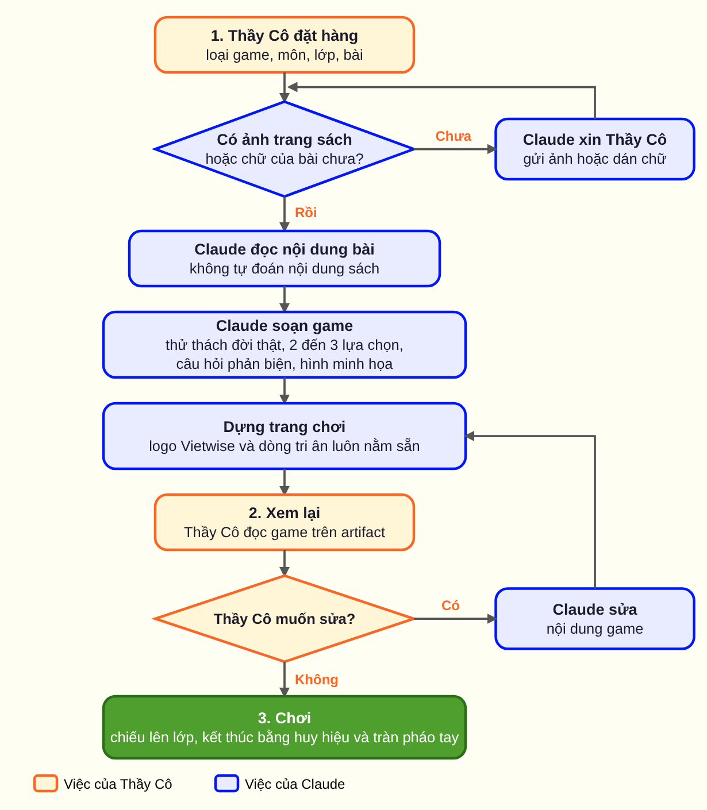
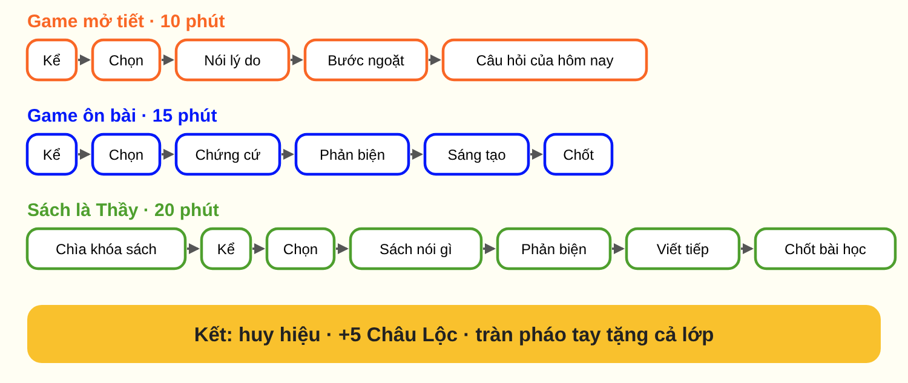

# Skill Game-học dành cho Thầy Cô

Tạo một trò chơi cho tiết học của Thầy Cô trong khoảng vài phút, chơi ngay trên Claude, chiếu lên màn hình lớp. Dịch vụ không thu phí.

Bộ này có 3 loại game, không thi đua, không chấm điểm:
- **Game mở tiết** (10 phút): một tình huống thật, một quyết định, khơi tò mò cho bài sắp học.
- **Game ôn bài** (15 phút): học sinh chọn, nêu chứng cứ từ bài, phản biện, nghĩ ra lựa chọn tốt hơn.
- **Sách là Thầy** (20 phút): học sinh đọc một cuốn sách rồi dùng chi tiết trong sách để bảo vệ lựa chọn.

## Cài đặt (một lần, khoảng 2 phút)
1. Đăng nhập Claude (bản miễn phí là đủ) tại claude.ai.
2. Vào mục cài đặt, tìm phần **Skills** (tên mục có thể đổi theo thời gian), chọn tải lên và chọn tệp `game-hoc-vietwise.zip`.
3. Bật Skill **game-hoc-vietwise**.

Nếu tài khoản của Thầy Cô chưa có mục Skills, hãy báo cho Vườn Game-học qua Vietwise.edu.vn để được hướng dẫn cách khác.

## Game đổi theo lớp, môn và ngoại ngữ
Trợ lý tự chọn cách viết theo lớp Thầy Cô nêu:
- **Nhóm lớp:** A (lớp 1 đến 3), B (4 đến 5), C (6 đến 7), D (8 đến 10), E (11 đến 12). Đổi giọng, lượng chữ, số lựa chọn. Lớp 8 đến 12 là phần mở rộng so với phạm vi gốc 3 đến 12 tuổi của Vườn Game-học.
- **Nhóm môn:** Toán, Khoa học, Ngữ văn, Xã hội, Ngoại ngữ, Nghệ thuật và Thể chất, Tin học. Đổi kiểu chứng cứ và hiểu lầm hay gặp.
- **Đọc ngoại ngữ:** Anh, Hàn, Nhật, Trung, Pháp, Đức, Nga và các thứ tiếng khác. Lời kể tiếng Việt, văn bản ngoại ngữ là chứng cứ, giữ nguyên chữ viết và dấu. Game không đọc thành tiếng, Thầy Cô đọc mẫu.
Mỗi game có ba mức (Khởi động, Vững vàng, Thử thách) ghi trong ghi chú Thầy Cô. Quy tắc gốc nằm trong `references/` (nhom-lop, nhom-mon, doc-ngoai-ngu, quy-tac-vietwise); có 9 game mẫu trong `references/vi-du/`.

## Dùng (dễ như 1-2-3)
1. **Giao việc cho Trợ lý Game-hóa**: nhắn cho Claude, ví dụ: "Tạo game ôn bài Khoa học tự nhiên lớp 8, bài mol và nồng độ", và gửi kèm **ảnh chụp trang sách** (bắt buộc, từ 1 đến 12 trang cho mỗi lần giao việc).
2. **Trả kết quả**: Trợ lý Game-hóa tạo game và trả về ngay thành một trang chơi. Thầy Cô xem lại, nói muốn sửa gì thì Trợ lý sửa nội dung.
3. **Chơi**: chiếu lên lớp. Phím mũi tên để sang bước, chạm vào thẻ để lật, nút "Chế độ Thầy Cô" (phím G) hiện đáp án và ghi chú riêng.

Tìm trang sách để chụp: trang tập huấn theo lớp tại https://taphuan.nxbgd.vn/tap-huan?grade=N (N từ 1 đến 12).

## Skill làm việc thế nào (sơ đồ)

Ô vàng là việc của Thầy Cô, ô xanh là việc của Claude.

**Dạng chữ (nếu máy không hiện được ảnh):** Thầy Cô giao việc, rồi gửi ảnh trang sách (1 đến 12 trang). Trợ lý đọc bài, soạn game, trả kết quả là một trang chơi trên artifact. Thầy Cô xem lại; muốn sửa thì nhờ Claude sửa rồi dựng lại. Hài lòng thì chiếu lên lớp và chơi.

### Trong một lượt chơi, cả lớp đi qua các bước

## Lưu ý
- Skill chỉ dùng nội dung Thầy Cô gửi, không tự bịa nội dung sách. Thầy Cô nên đọc lại game trước khi chiếu, nhất là số liệu trong phần ghi chú.
- Mỗi trang game luôn có phần ghi nguồn Vietwise ở đầu trang (logo Viện Giáo dục và Quản trị Nhân lực và logo Vườn Game-học Vietwise, bấm vào mở Vietwise.edu.vn) và dòng tri ân Thầy Cô ở cuối trang. Đây là điều kiện dùng miễn phí và Skill không cho phép sửa hoặc xóa phần này. Xem NOTICE.md.

Cung cấp bởi Viện Giáo dục và Quản trị Nhân lực & Vườn Game-học Vietwise, https://vietwise.edu.vn
